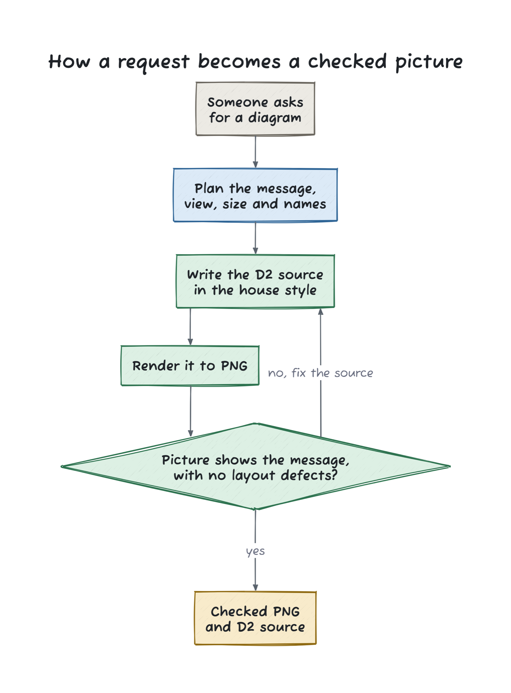

# diagrams-skill

[](https://github.com/asabirov/diagrams-skill/releases/latest)

Readable diagrams with a consistent visual style, all drawn in D2 in a hand-drawn style.



This is an agent skill. When someone has to review architecture, states, conditional logic, an exchange of messages, a data model or a customer journey, the agent picks the diagram type that fits the question.

**[See an example of all 11 diagram types](docs/examples.md)**

## Why it exists, and what it turned down

Left alone, an agent tends to draw a flowchart for everything, use the default styling and call a diagram done once it parses. This skill makes it choose the view by the question, use one shared palette and look at the result.

| Turned down | Reason |
| --- | --- |
| Two diagram languages | Earlier versions drew sequence and state diagrams with Mermaid. D2 draws both, so one language, one palette and one render loop cover every view. |
| Colour defined inside each box | One classes block names each kind of part. Each box only names its class. |
| Invented journey scores | Journeys are flows that start at a person, with no scores unless real scores are supplied. |
| Parsing as proof | A diagram that compiles can still clip text or hide a label under a line. Only a checked render counts as verified. |
| Other layout tools | D2 with the ELK layout gave the cleanest layout of the free tools tested: D2, Graphviz, LikeC4, Mermaid and Excalidraw. Its sketch mode gives a hand-drawn look. |
| Review-page building | The skill makes diagrams. It does not build the page they are reviewed on. |

## The design

| Choice | What it means |
| --- | --- |
| Colour carries meaning | Each kind of part, such as a way in, a core service or stored records, has one fill. Labels name each part, so the meaning is clear without colour. |
| The picture is the output | Hosts such as GitHub do not render D2. The agent shares the checked PNG, and attaches it to an issue or a PR without a commit. |
| Rare features load on demand | The agent reads the features reference only when a diagram needs it. |

## How to run and verify it

Install the latest version:

```sh
DO_NOT_TRACK=1 npx skills add https://github.com/asabirov/diagrams-skill --skill diagrams --agent claude-code codex --global
```

Update it later:

```sh
DO_NOT_TRACK=1 npx skills update diagrams --global
```

`DO_NOT_TRACK=1` turns off the telemetry of the skills CLI. The CLI needs Node.js, npm and Git.

The CLI finds the installed agents. To choose agents, add `--agent <name>`. `DO_NOT_TRACK=1` turns off the CLI's telemetry.

| Dependency | Needed for |
| --- | --- |
| Node.js, npm and Git | Running the install command |
| [D2](https://d2lang.com) (tested with 0.9.0) | Drawing every diagram. Without it the agent can write diagrams but cannot render or check them |
| [Playwright CLI](https://playwright.dev) with its Chromium headless shell (tested with 1.65.0) | Turning a D2 SVG into a PNG, because D2's own PNG export installs its own Chromium |
| Geist font (optional) | Diagram text. Arial is used when Geist is not installed |

Then start a new agent session and ask for a diagram:

> Show the states an order goes through, including refunds.

The agent should choose a state diagram, render it and check the PNG.

## Licence

[MIT](LICENSE), © 2026 Artur Sabirov.
