# Diagram examples

Each picture is a render of its source in [checks/](../checks/), made with D2 0.9.0 and the render command in [SKILL.md](../SKILL.md). The examples are about a fictional online shop.

## Box diagram

What connects, and where are the boundaries? [Source](../checks/architecture.d2)

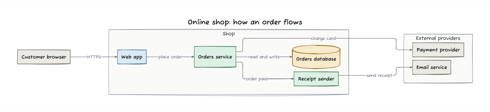

## Flow

Which conditions lead to which outcomes? [Source](../checks/flow.d2)

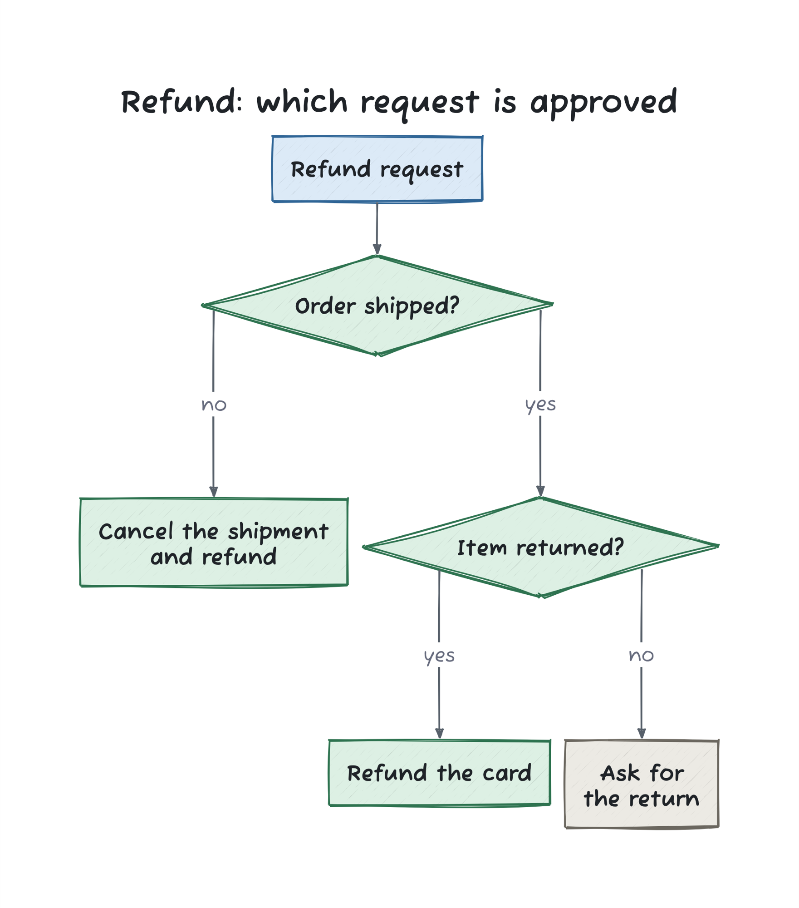

## Customer journey

What does the customer do, including interruptions? [Source](../checks/journey.d2)

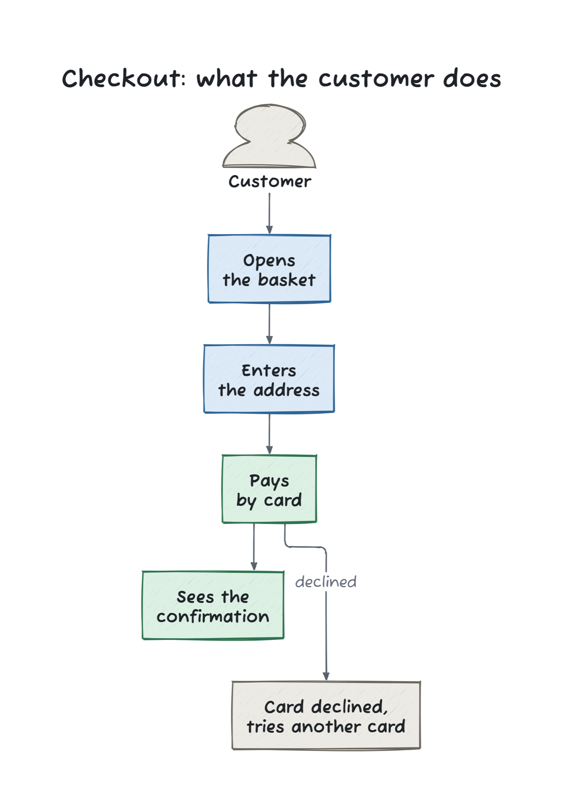

## State diagram

Which states and transitions are possible? [Source](../checks/state.d2)

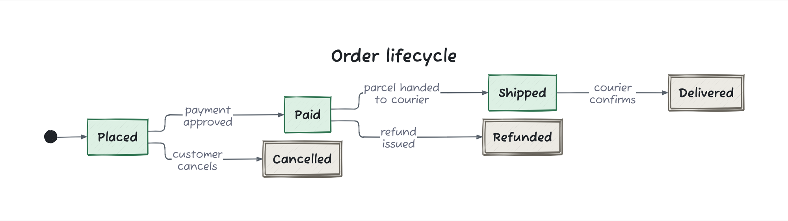

## Sequence diagram

Who sends what, in what order? [Source](../checks/sequence.d2)

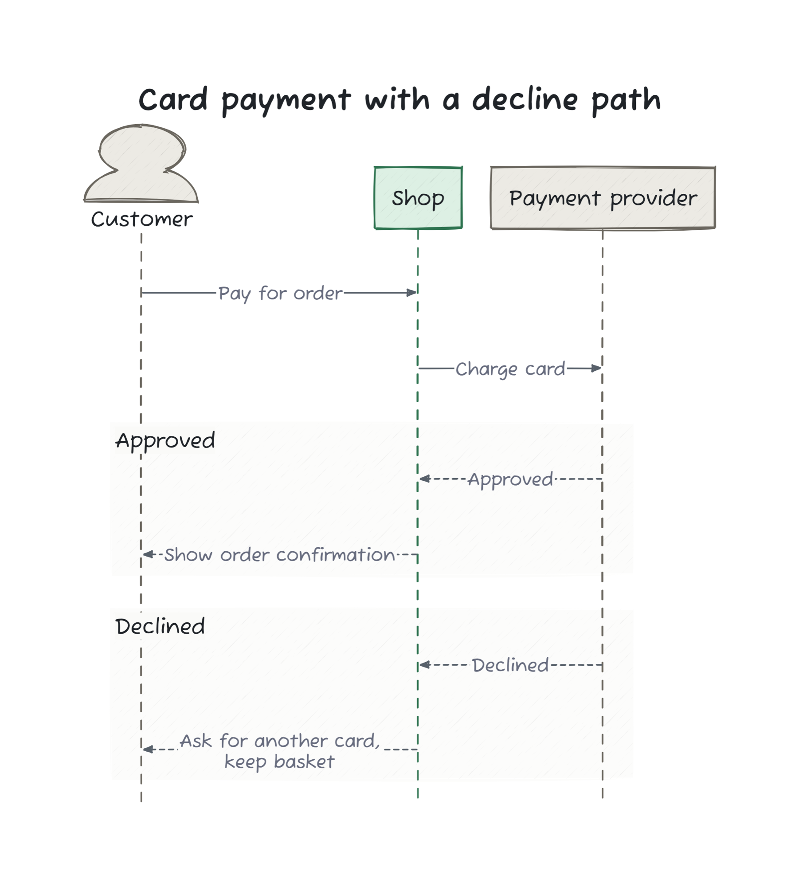

## Data tables

Which tables hold the data, and how do they join? [Source](../checks/tables.d2)

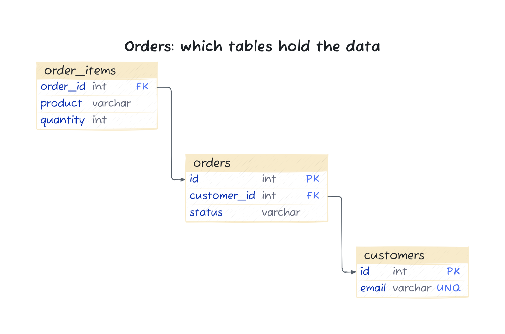

## Code structure

How is the code structured? [Source](../checks/classes.d2)

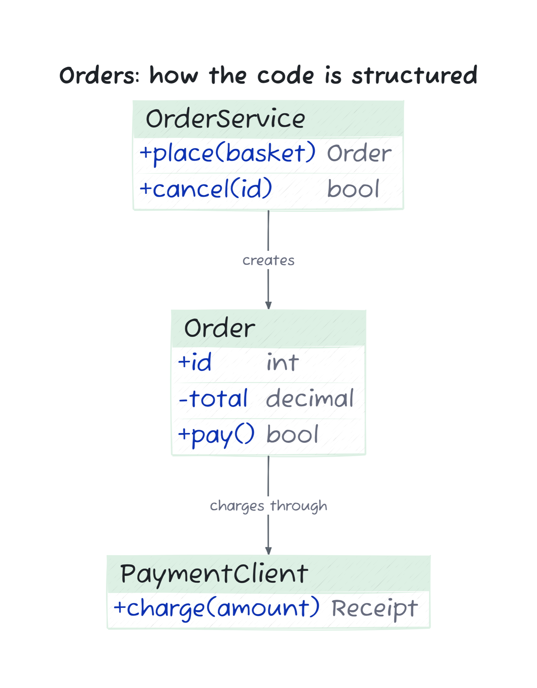

## Scenarios

How do variants of one system differ? [Source](../checks/scenarios.d2)

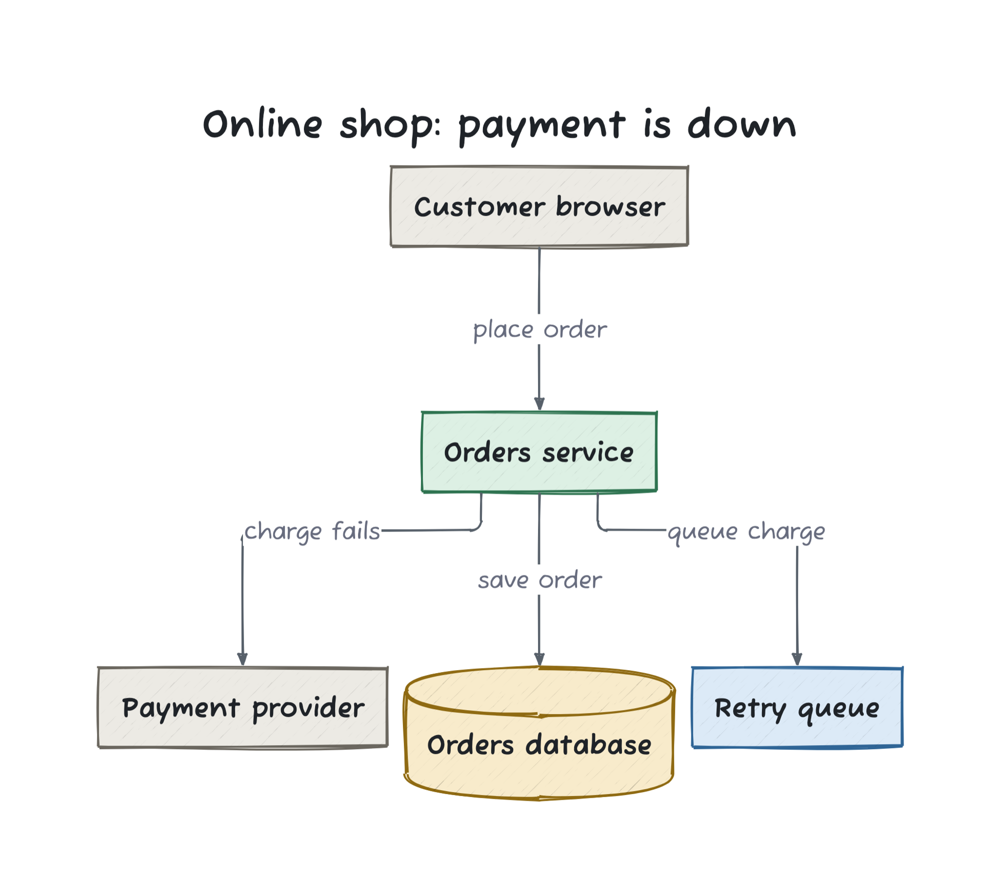

## Steps

What happens at each stage, in order? [Source](../checks/steps.d2)

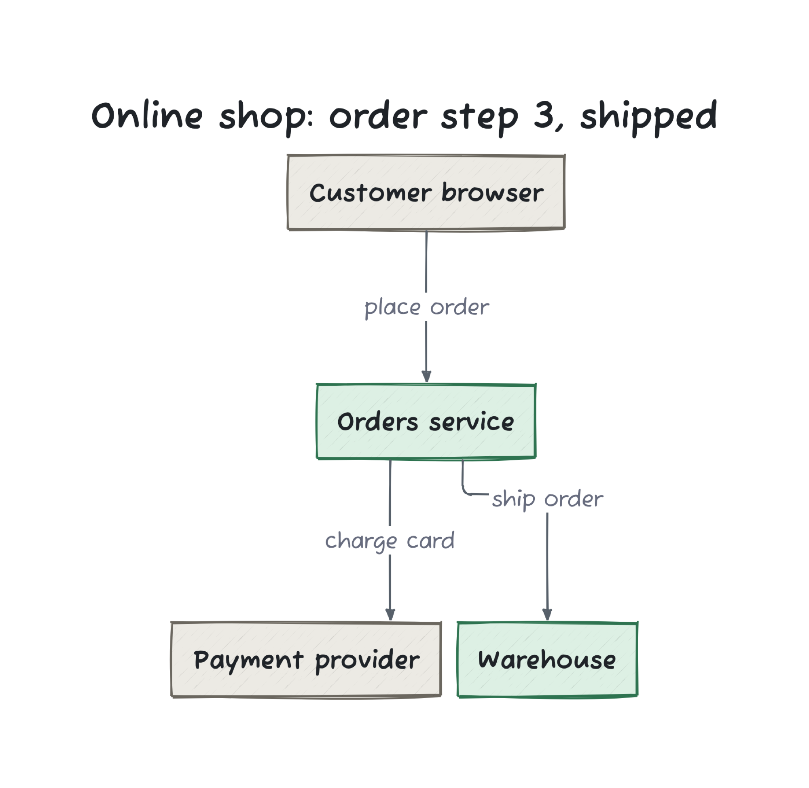

## Layers

What is inside one part of an overview? [Source](../checks/layers.d2)

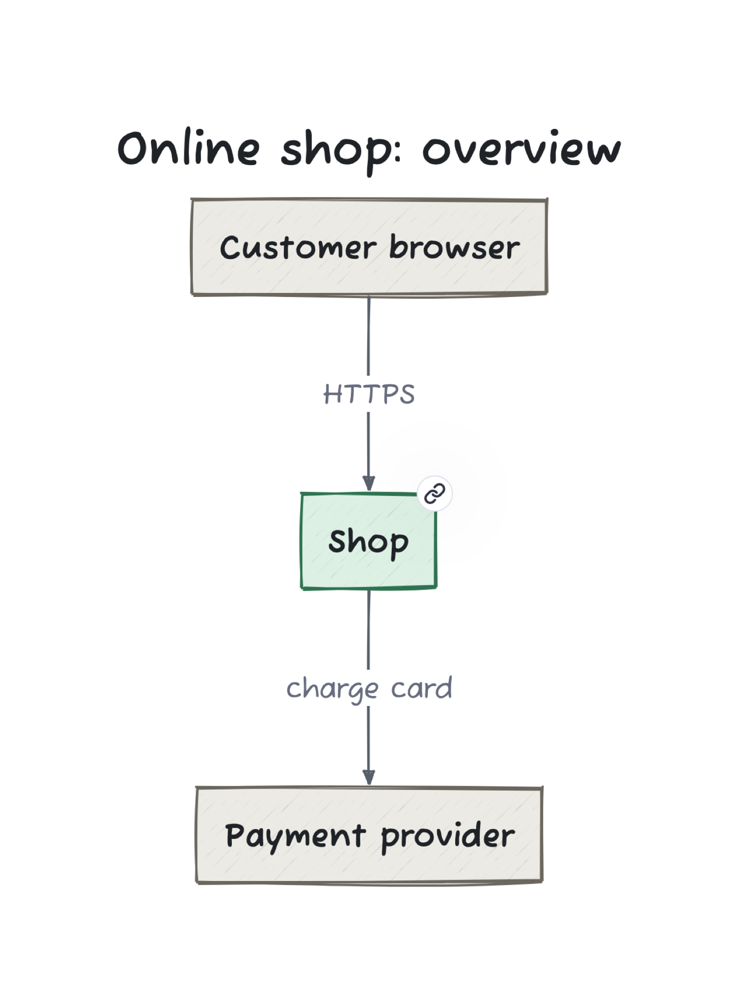

## Tiles

How do similar items compare? [Source](../checks/grid.d2)

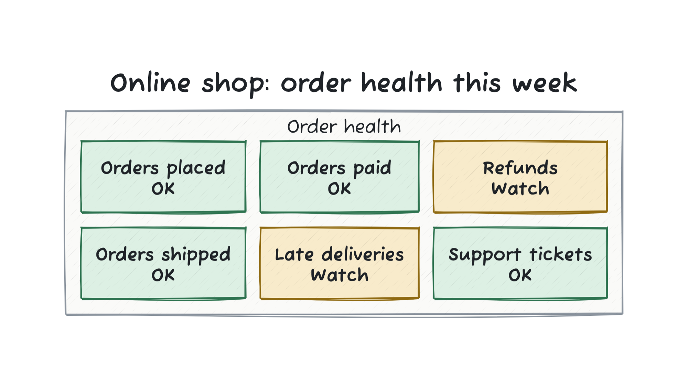
